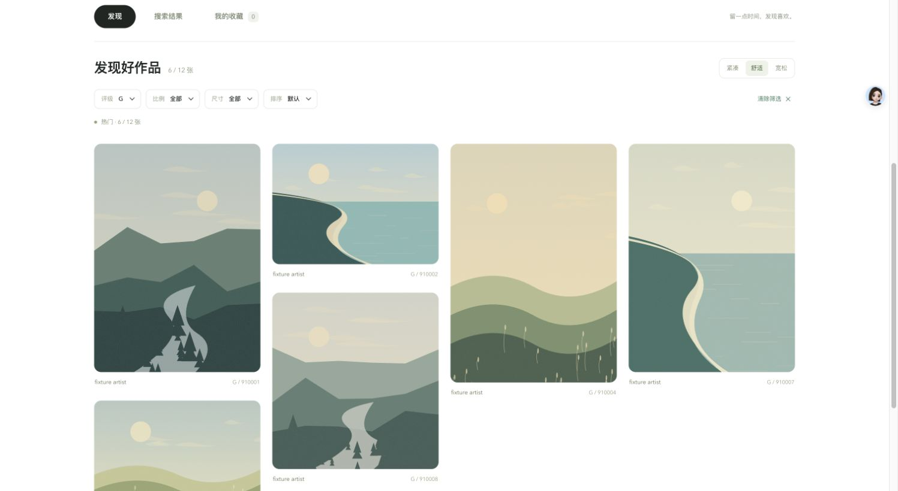

<p align="center">
  
</p>

<p align="center">
  <b>在喜欢的画面里，找到新的可能。</b><br />
  一个纯静态的 Danbooru 多标签搜索与图片浏览工具。打开网页，就能搜索、筛选与收藏。
</p>

<p align="center">
  <a href="https://eeriekarasu.github.io/danbooru-search/"><b>在线体验 ↗</b></a> &nbsp; · &nbsp;
  <a href="#快速开始">快速开始</a> &nbsp; · &nbsp;
  <a href="#搜索是怎样工作的">搜索原理</a> &nbsp; · &nbsp;
  <a href="tests/README.md">开发检查</a>
</p>

<p align="center">
  
  
  
</p>

---

## 从搜索到收藏，少一点打断

<table>
  <tr>
    <td width="50%" valign="top">
      <h3>01 / 用标签找到画面</h3>
      <p>组合多个标签搜索；前两个标签参与远程查询，后续标签在浏览器中过滤。常用标签入口与最近 20 个标签，让下一次检索更顺手。</p>
    </td>
    <td width="50%" valign="top">
      <h3>02 / 按你的方式浏览</h3>
      <p>自适应瀑布流，提供紧凑、舒适、宽松三种密度；按评级、比例、尺寸筛选，也能按得分、收藏数、尺寸或最新作品排序。</p>
    </td>
  </tr>
  <tr>
    <td width="50%" valign="top">
      <h3>03 / 看大图，也能继续发现</h3>
      <p>打开大图后，用方向键切换作品、Esc 关闭；点击作品标签继续搜索，或跳转到 Danbooru 原作品页面。</p>
    </td>
    <td width="50%" valign="top">
      <h3>04 / 留下喜欢的作品</h3>
      <p>收藏、搜索历史与浏览偏好保存在当前浏览器。加载中可以停止，失败后可以重试，图片失效时仍保留原作品入口。</p>
    </td>
  </tr>
</table>

## 界面一览

<a href="https://eeriekarasu.github.io/danbooru-search/">
  
</a>

<p align="center"><sub>预览使用仓库自带风景插画与固定测试数据，展示 G 评级筛选；不是 Danbooru 实时搜索结果。</sub></p>

## 快速开始

### 直接使用

打开 **[在线体验](https://eeriekarasu.github.io/danbooru-search/)**，输入以空格分隔的标签，按回车搜索，例如：

```text
scenery sky ocean
```

在结果上方调整筛选条件；点击图片查看大图，点击爱心加入收藏。「浏览设置」可以保存默认加载数量、评级、排序、图库密度与作品信息显示偏好。

默认评级为 **全部（All）**。需要只浏览 G 评级作品时，可在筛选栏选择 G，或在浏览设置里保存默认评级。

### 本地运行

无需安装项目依赖，也无需配置 API Key。下载项目后可以直接打开 `index.html`，或使用静态服务器：

```bash
git clone https://github.com/eErieKarasu/danbooru-search.git
cd danbooru-search
python3 -m http.server 4173
```

访问 **http://localhost:4173**。

## 搜索是怎样工作的

保留最初 Python 脚本的多标签思路，在浏览器中完成远程检索与本地过滤：

```text
输入：scenery sky ocean
       └────┬────┘ └─┬─┘
         远程查询    本地过滤
       前 2 个标签   其余标签

Danbooru /posts.json → 分页读取 → 本地标签 / 评级过滤 → 去重 → 图库
```

「加载数量」是目标结果数。程序会分页读取，直到达到目标或远程结果结束；标签越多、条件越严格，最终匹配数量可能越少。加载中可随时停止。

- **直接连接**：浏览器匿名请求 Danbooru API；站点本身无需后端或代理服务，实际可用性取决于网络与接口响应。
- **本地保存**：收藏、历史与设置使用 `localStorage`，仅保存在当前浏览器及站点来源下，不在设备间同步。沿用原存储键，升级无需迁移已有本地数据。
- **原站内容**：图片与标签来自 Danbooru，原作品链接保留在卡片及预览中。

## 部署到 GitHub Pages

1. 将项目推送到自己的 GitHub 仓库。
2. 在 **Settings → Pages → Source** 选择 **GitHub Actions**。
3. 推送到 `main` 或 `master` 后，现有 [部署工作流](.github/workflows/deploy-pages.yml) 会自动发布。

这是一个静态站点，也可以放到其他静态托管服务。

<details>
<summary><b>开发者入口：目录与检查方式</b></summary>

```text
index.html             页面结构与交互入口
css/styles.css         响应式布局与视觉样式
js/app.js              搜索、筛选、收藏与预览逻辑
assets/                图标与文档图片
.github/workflows/     GitHub Pages 自动部署
tests/                 静态检查与固定数据预览
prototypes/            设计参考原型与本地示例插画
```

静态检查：

```bash
python3 tests/check_static.py
```

使用本地固定数据预览与回归：

```bash
python3 tests/preview_server.py
```

打开 http://127.0.0.1:4174/ 。该服务仅绑定本机，复用正式前端并临时替换请求地址，不修改正式源码；不会请求 Danbooru 实时作品。

完整步骤见 [浏览器回归说明](tests/README.md)。[设计参考原型](prototypes/pexels-inspired/) 仅供参考，正式入口不依赖其脚本或示例图库。

</details>

---

<p align="center"><sub>发现 · 搜索 · 收藏<br />A little discovery, every day.</sub></p>
